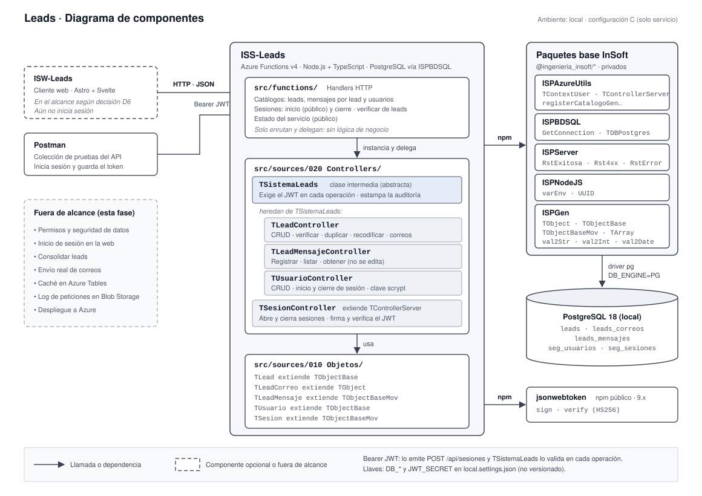

# Componentes

## Todo el código propio vive en el servicio

El proyecto usa la configuración C (decisión D1 de la [Ficha de proyecto](../010-Planteamiento/010-Ficha-de-proyecto.md)): no se crea ni publica ningún paquete npm propio. Objetos y controladores viven dentro de `ISS-Leads`, separados de los handlers, y heredan de los paquetes base de InSoft.

| Componente | Responsabilidad | Se comunica con |
| --- | --- | --- |
| `ISW-Leads` | Cliente web en Astro + Svelte (decisión D6). Inicia y cierra sesión contra `ISS-Leads`, guarda el token en la cookie `istoken`, que el navegador no puede leer, y llama al API a través de su proxy `/api` | `ISS-Leads` por HTTP, desde su servidor |
| Postman | Colección que prueba y documenta cada operación del API; inicia sesión y guarda el token | `ISS-Leads` por HTTP |
| `src/functions/` | Registra las rutas HTTP, instancia el controlador y delega. No tiene lógica de negocio | Controladores |
| `TSistemaLeads` | Clase intermedia abstracta: exige el JWT en cada operación y estampa la auditoría del Modelo B | `TSesionController` |
| `TLeadController` | CRUD, verificar, listar, duplicar y recodificar el lead; guarda los correos como detalle y los entrega dentro del lead | `ISPAzureUtils`, PostgreSQL |
| `TLeadMensajeController` | Registra, lista y consulta los mensajes de un lead; valida que el destinatario sea un correo del lead | `ISPAzureUtils`, PostgreSQL |
| `TUsuarioController` | CRUD de usuarios, inicio y cierre de sesión; guarda la clave como hash scrypt y nunca la entrega | `TSesionController`, PostgreSQL |
| `TSesionController` | Abre y cierra sesiones en `seg_sesiones`, firma el JWT y lo verifica | `jsonwebtoken`, PostgreSQL |
| `TLead`, `TLeadCorreo`, `TLeadMensaje`, `TUsuario`, `TSesion` | Objetos de dominio: los de tablas de datos extienden `TObjectBase`, los de movimiento `TObjectBaseMov` y el detalle `TObject` | — |
| Paquetes base InSoft | Controlador CRUD (`TControllerServer`), registro de rutas de catálogo, conexión a BD, respuestas REST y conversores de tipo | PostgreSQL (vía `ISPBDSQL`) |
| PostgreSQL 18 | Guarda `leads`, `leads_correos`, `leads_mensajes`, `seg_usuarios` y `seg_sesiones` | — |

`TLeadController`, `TLeadMensajeController` y `TUsuarioController` heredan de `TSistemaLeads`, la clase intermedia que pide la norma del paquete servidor: el token y la auditoría se resuelven una sola vez ahí, no en cada controlador. `TSesionController` extiende `TControllerServer` directamente, porque es la que valida el token y no puede exigirlo.

## Integraciones

| Sistema | Dirección y protocolo | Contrato y versión | Autenticación | Ante falla | Restricciones |
| --- | --- | --- | --- | --- | --- |
| PostgreSQL 18 local | `ISS-Leads` → BD, driver `pg` vía `ISPBDSQL` (`DB_ENGINE=PG`) | [Modelo de datos](../030-Modelado-de-datos/010-Modelo-de-datos.md) | Usuario y clave de la BD en `local.settings.json`, no versionado | La operación responde 500 con `RstError`; cada escritura corre en una transacción, así que no queda nada a medias | Solo ambiente local |
| Consumidores (`ISW-Leads`, Postman) | Consumidor → `ISS-Leads`, HTTP REST con JSON | [Colección de Postman](../999-Adjuntos/020-Ejemplos/010-ISS-Leads.postman_collection.json) y su [ambiente local](../999-Adjuntos/020-Ejemplos/020-ISS-Leads-Local.postman_environment.json) | Header `Authorization: Bearer <JWT>` que emite el inicio de sesión y valida `TSistemaLeads`; la web lo arma en su servidor con la cookie `istoken` (ver [Seguridad](../040-Procesos/010-Seguridad.md)) | El consumidor recibe la respuesta estándar de `ISPServer` con el código y el mensaje del error; sin token válido, `401`, y la web lleva al usuario a `/login` con la ruta en la que estaba | Cualquier usuario con sesión accede a todo: no hay roles en esta fase |

## Dependencias

| Depende de | Qué pasa si no está |
| --- | --- |
| Paquetes `@ingenieria_insoft/*` (`ISPGen`, `ISPNodeJS`, `ISPServer`, `ISPBDSQL`, `ISPAzureUtils` 2.x) | `npm ci` falla con 401/403/404 y el servicio no compila |
| `jsonwebtoken` 9.x (npm público) | No se pueden firmar ni verificar tokens: el servicio no compila |
| Token de npm en el `.npmrc` | No se pueden instalar los paquetes privados |
| `JWT_SECRET` en `local.settings.json` | El inicio de sesión y toda operación con token responden 500 |
| PostgreSQL 18 corriendo, con las tablas y secuencias creadas | Todas las operaciones responden 500 |
| Al menos un usuario activo en `seg_usuarios` | Nadie puede iniciar sesión; el primero se crea como dice [Seguridad](../040-Procesos/010-Seguridad.md) |
| Azure Functions Core Tools (`func start`) | El servicio no arranca en local |
