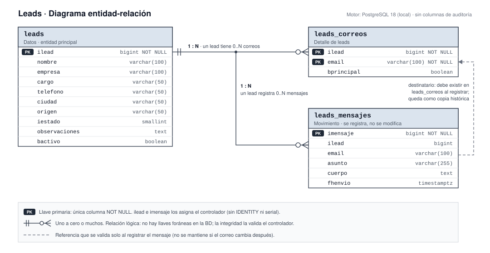

# Modelo de datos

## Cada tabla tiene un tipo y ninguna lleva auditoría

El tipo dice cómo se comporta la tabla; por decisión del proyecto ninguna lleva columnas de auditoría (ver [Ficha de proyecto](../010-Planteamiento/010-Ficha-de-proyecto.md)).

| Tabla | Tipo | Llave primaria | Objeto | Se modifica |
| --- | --- | --- | --- | --- |
| `leads` | Datos (entidad principal) | `ilead` | `TLead` | Sí |
| `leads_correos` | Detalle de `leads` | `ilead`, `email` | `TLeadCorreo` | Solo a través del lead |
| `leads_mensajes` | Movimiento de `leads` | `imensaje` | `TLeadMensaje` | No: se registra una vez |

Los tres objetos extienden `TObject` de `ISPGen`: `TObjectBase` y `TObjectBaseMov` exigen columnas de auditoría que estas tablas no tienen.

## Las relaciones las valida el controlador, no la base de datos

La BD no declara llaves foráneas (norma InSoft), así que estas reglas viven en el controlador y fallan con un `Rst400` si no se cumplen:

1. `leads_correos.ilead` y `leads_mensajes.ilead` deben existir en `leads`.
2. Al registrar un mensaje, `leads_mensajes.email` debe existir en `leads_correos` para ese mismo lead. Queda como copia histórica: si después se borra o cambia el correo, el mensaje conserva la dirección a la que salió.
3. Un lead tiene como máximo un correo con `bprincipal = true`.
4. `ilead` e `imensaje` los asigna el controlador con `nextVal` de `ISPBDSQL` sobre las secuencias `seq_leads` y `seq_leads_mensajes`. Las columnas no usan `IDENTITY` ni `serial` (decisión D3).
5. Toda columna admite nulos salvo la llave primaria; los obligatorios de negocio se validan en el controlador: `leads.nombre`, `leads_correos.email`, y en el mensaje `email`, `asunto` y `fhenvio`.

## El lead arrastra distintas tablas según la operación

Las operaciones del controlador base recorren dos listas de tablas: `tblsDuplicate` (duplicar y eliminar) y `tblsRecode` (recodificar). Esta es la propuesta de la decisión D2:

| Operación | `leads` | `leads_correos` | `leads_mensajes` |
| --- | --- | --- | --- |
| Duplicar | Copia con el `ilead` nuevo | Copia | No se copian: son historia del lead original |
| Recodificar | Cambia `ilead` | Cambia `ilead` | Cambia `ilead` |
| Eliminar | Borra | Borra | Si el lead tiene mensajes, la eliminación se rechaza |
| Modificar | Actualiza | Se reemplazan por los que llegan en el lead | No se tocan |

## El estado del lead es una lista cerrada

`iestado` guarda un valor del enum `TEstadoLead`. La lista es una propuesta (supuesto S2):

| Valor | Estado | Significa |
| --- | --- | --- |
| 1 | Nuevo | Registrado, sin contacto todavía |
| 2 | Contactado | Ya recibió al menos un mensaje o llamada |
| 3 | Calificado | Tiene interés real y cumple el perfil |
| 4 | Descartado | No continúa en el proceso |
| 5 | Convertido | Pasó a ser cliente |

`origen` es texto libre (por ejemplo: sitio web, referido, evento) hasta que el negocio defina una lista.
