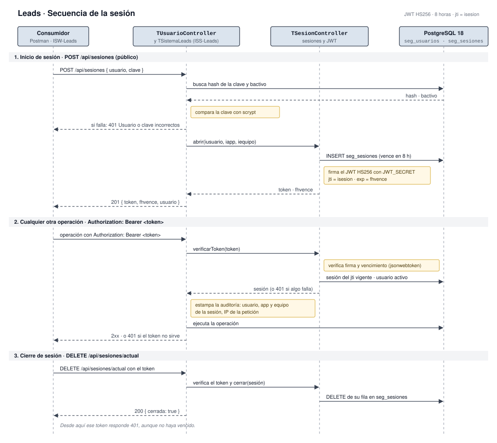

# Seguridad



## Toda operación exige un token, salvo dos endpoints públicos

`ISS-Leads` responde `Rst401` a cualquier petición sin un JWT válido. Solo dos endpoints son públicos, y cada uno tiene su motivo:

| Endpoint | Por qué es público |
| --- | --- |
| `OPTIONS /api/{rest?}`, estado del servicio | Health-check estándar del paquete base: solo informa la versión y si la BD responde |
| `POST /api/sesiones`, inicio de sesión | Es la única forma de obtener un token |

La validación vive en una sola clase, `TSistemaLeads` (ver [Componentes](../020-Arquitectura/020-Componentes.md)), de la que heredan los controladores de leads, mensajes y usuarios. Cada operación verifica el token antes de validar datos o consultar la BD, para que una petición sin sesión no revele si un recurso existe ni consuma secuencias. El detalle de cada endpoint está en la colección de Postman.

## El token es la llave de una sesión guardada en la BD

**Transporte:** header `Authorization: Bearer <token>`. En la web, el token viaja del navegador al servidor de `ISW-Leads` en la cookie `istoken`, y ese servidor arma el header.

**Encabezado:** `{ "alg": "HS256", "typ": "JWT" }`, firmado con la llave `JWT_SECRET`.

**Payload:** reutiliza la interfaz `IInfoAuthorization` de `ISPGen` (no se crea un tipo nuevo) más los claims estándar.

| Claim | Tipo | Contenido |
| --- | --- | --- |
| `usuario` | `string` (máx. 30) | Usuario que inició sesión, en minúscula |
| `iapp` | `keyof typeof TIS_IApp` | Aplicación desde la que inició sesión; por defecto `IAppOther`, y `WebLogin` desde `ISW-Leads` |
| `iequipo` | `number` | Equipo desde el que inició sesión; por defecto 0 |
| `jti` | `string` | `isesion` de la fila de `seg_sesiones` |
| `iat`, `exp` | `number` (segundos Unix) | Emisión y vencimiento, 8 horas después |

Ejemplo con datos sintéticos:

```json
{ "usuario": "dev01", "iapp": "IAppOther", "iequipo": 1, "jti": "25", "iat": 1793000000, "exp": 1793028800 }
```

El servicio acepta el token solo si se cumplen las cuatro condiciones, en este orden:

1. La firma es válida con `JWT_SECRET` y el token no venció (`jsonwebtoken.verify`, solo HS256): un token sin firma o firmado con otra llave no pasa.
2. La sesión del `jti` existe en `seg_sesiones` y es del mismo `usuario`: así un token se puede invalidar antes de que venza.
3. El `fhvence` guardado de la sesión no pasó: el vencimiento manda desde la BD y no desde el payload, como pide la norma del paquete servidor.
4. El usuario sigue activo en `seg_usuarios`: desactivarlo corta sus tokens vigentes.

La auditoría de cada registro toma el usuario, la aplicación y el equipo de esa sesión, y la IP de la petición (ver [Modelo de datos](../030-Modelado-de-datos/010-Modelo-de-datos.md)).

## La sesión dura 8 horas o hasta que se cierre

| Momento | Disparador | Resultado observable | Si falla |
| --- | --- | --- | --- |
| Abrir | `POST /api/sesiones` con usuario y clave | Fila nueva en `seg_sesiones` y respuesta `201` con `token` y `fhvence` | `400` si falta el usuario o la clave; `401` «Usuario o clave incorrectos» si no existe, está inactivo o la clave no coincide |
| Usar | Cualquier operación con el token | La operación responde normalmente y deja la auditoría del usuario de la sesión | `401` si la firma no es válida, venció, la sesión ya no existe o el usuario está inactivo |
| Cerrar | `DELETE /api/sesiones/actual` | La fila desaparece y el token responde `401` desde ese momento | `401` si el token ya no servía |
| Vencer | Pasan 8 horas | El token responde `401`; la fila queda en `seg_sesiones` | — |
| Desactivar o eliminar el usuario | `bactivo` en `false`, o eliminar el usuario | Sus tokens dejan de servir; al eliminarlo se borran también sus sesiones | — |

El API no tiene registro público: crear un usuario exige token. En una BD nueva, el primer usuario se crea con una sesión temporal que el desarrollador abre directo en `seg_sesiones` y borra después.

## La web guarda el token en una cookie que el navegador no puede leer

`ISW-Leads` no llama a `ISS-Leads` desde el navegador. Lo hace su servidor (SSR en el Worker de Cloudflare), que es el único que conoce el token: el JavaScript de la página nunca lo recibe, así que un script inyectado no lo puede robar.

| Pieza | Qué hace |
| --- | --- |
| `POST /api/sesion` | Abre la sesión en `ISS-Leads` con el usuario, la clave y `iapp` `WebLogin`, y guarda el token en la cookie `istoken`. Al navegador solo le responde el usuario y el vencimiento |
| Cookie `istoken` | `HttpOnly`, `Secure`, `SameSite=Strict`, `Path=/` y el mismo vencimiento de la sesión. El token no pasa por `localStorage` ni por `document.cookie` |
| `src/middleware.ts` | Lista explícita de rutas privadas: `/leads` y todo lo que cuelga de ella. Sin sesión vigente redirige a `/login?volver=<ruta>`, y borra la cookie si el token venció o no se puede leer |
| `/login` | Pública. Quien ya tiene sesión vuelve a su ruta sin ver el formulario |
| Proxy `/api/leads…` | Arma el header `Authorization: Bearer` con la cookie. Sin cookie responde `401` sin llamar al API y sin redirigir; si el API responde `401`, borra la cookie |
| `DELETE /api/sesion` | Cierra la sesión en `ISS-Leads` y borra la cookie, aunque el API no responda |

Tres reglas cierran los huecos habituales de este esquema:

- **La ruta de retorno solo puede ser del mismo sitio.** Se acepta si `new URL(volver, origen).origin === origen`. Revisar que empiece por `/` no basta, porque `//dominio` y `/\dominio` también salen del sitio. Tampoco se vuelve a `/login` ni a `/api/`.
- **Las escrituras desde otro origen responden `403`**, en el proxy y en `/api/sesion`, además de lo que ya bloquea `SameSite=Strict`.
- **El middleware no verifica la firma del token**: solo lee el usuario y el vencimiento para decidir la redirección y mostrar quién tiene la sesión. `JWT_SECRET` vive solo en `ISS-Leads` y los datos llegan siempre por el API, que sí verifica la firma; una cookie falsificada solo deja ver la página vacía.

Si el API responde `401` en medio del uso, porque la sesión venció o se cerró desde otro lado, el navegador vuelve a `/login` con la ruta en la que estaba.

## La clave nunca se guarda ni se entrega en texto plano

- Se guarda como hash **scrypt** con sal propia de 16 bytes, en el formato `scrypt$<sal>$<hash>` (Base64URL). SHA-256 se descartó porque es rápido y sin sal: si la tabla se filtra, las claves se prueban por fuerza bruta y dos claves iguales dan el mismo hash.
- El hash se calcula en `TUsuarioController` con `node:crypto`. Los objetos de `010 Objetos/` no importan nada de Node, como pide la norma para el código que comparten cliente y servidor.
- La clave tiene al menos 8 caracteres.
- Ninguna respuesta de usuarios trae la columna `clave`, ni siquiera si el consumidor la pide en `campos`.
- El inicio de sesión responde el mismo `401` y tarda lo mismo si el usuario no existe, está inactivo o la clave no coincide, para no revelar cuál de las tres falló.

## Inventario de datos sensibles

| Dato | Dónde está | Cómo se protege | Quién lo ve |
| --- | --- | --- | --- |
| Nombre, empresa, cargo, teléfono y ciudad del lead | `leads` | BD local con acceso solo por token; en el repositorio y en Postman solo datos sintéticos | Usuarios con sesión |
| Correos del lead | `leads_correos`, `leads_mensajes.email` | Igual que el anterior | Usuarios con sesión |
| Contenido de los mensajes | `leads_mensajes.asunto`, `leads_mensajes.cuerpo` | Igual que el anterior | Usuarios con sesión |
| Hash de la clave | `seg_usuarios.clave` | scrypt con sal propia; ninguna respuesta lo entrega | Solo quien accede directo a la BD |
| Usuario, equipo e IP de cada cambio | Columnas de auditoría y `seg_sesiones` | BD local; viajan solo en las respuestas del propio recurso | Usuarios con sesión |

## Inventario de secretos

| Secreto | Dónde se guarda | Quién lo rota |
| --- | --- | --- |
| Usuario y clave de PostgreSQL local | `local.settings.json` de `ISS-Leads`, fuera del control de versiones | Desarrollador |
| Llave de firma del JWT (`JWT_SECRET`) | `local.settings.json` de `ISS-Leads` en local; Application Settings de la Function App al desplegar | Desarrollador en local; *Pendiente · Líder técnico* al desplegar |
| Token de npm para `@ingenieria_insoft/*` | `.npmrc` del usuario o de cada pieza, nunca en el repositorio | Líder técnico |
| Usuario, clave y token de Postman | *Current value* del ambiente `020-ISS-Leads-Local`; el archivo exportado los lleva vacíos | Cada desarrollador |
| Token de la sesión de cada usuario de la web | Cookie `istoken` del navegador (`HttpOnly`, `Secure`, `SameSite=Strict`); solo la lee el servidor de `ISW-Leads` | Cambia en cada inicio de sesión; vence a las 8 horas o al cerrar sesión |

Rotar `JWT_SECRET` invalida todos los tokens emitidos: cada usuario debe iniciar sesión de nuevo.

## Riesgos aceptados

| Riesgo | Por qué se acepta | Aprueba |
| --- | --- | --- |
| Cualquier usuario con sesión ve y modifica todos los leads, los mensajes y los usuarios: no hay roles ni seguridad de datos (`segDatosWhere`) | Fase local con usuarios de prueba; los permisos están en «No incluye» de la [Ficha de proyecto](../010-Planteamiento/010-Ficha-de-proyecto.md) | *Pendiente · Líder técnico* |
